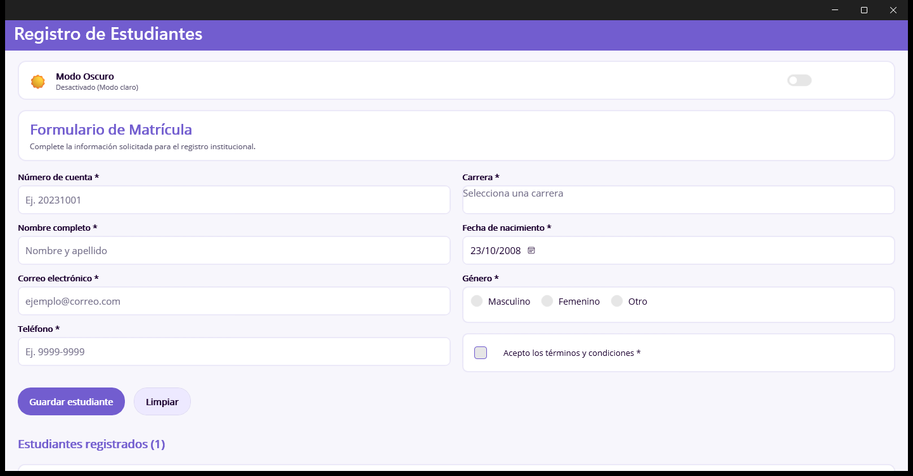
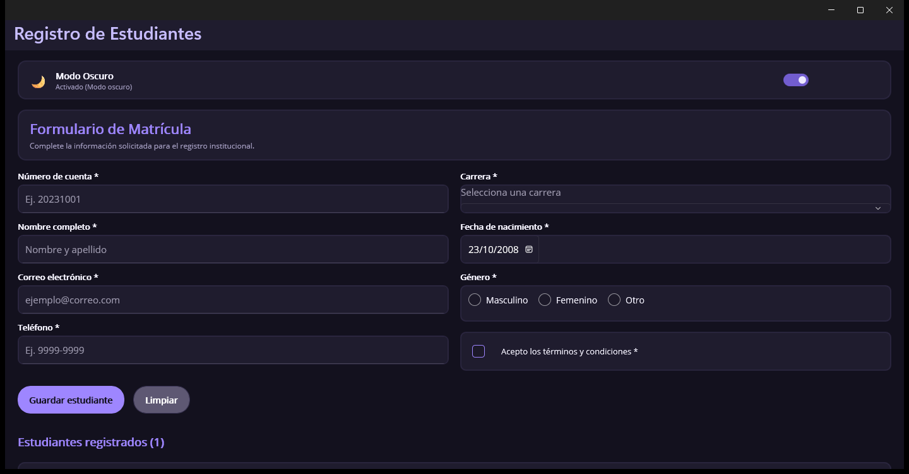

# Registro de Estudiantes — .NET MAUI

**Universidad Cristiana Evangélica Nuevo Milenio (UCENM)**  
**Asignatura:** Programación para Dispositivos Móviles II  
**Unidad 2:** Recursos XAML, Estilos, Temas y Diseño Adaptable  
**Tarea de desarrollo 16:** Proyecto: Formulario con estilos y temas  

---

## 📋 Descripción del Proyecto

Aplicación móvil y de escritorio multiplataforma desarrollada en **.NET MAUI** para el registro institucional y matriculación de estudiantes, integrando almacenamiento local con **SQLite** y una interfaz moderna con soporte para estilos implícitos y explícitos, temas dinámicos (claro y oscuro), estados visuales de enfoque y diseño adaptable según el tipo de dispositivo.

---

## 🎨 Paleta de Colores de la Aplicación

La paleta institucional se encuentra centralizada en `Resources/Styles/Colors.xaml`, asegurando consistencia visual y evitando valores fijos (*hardcoded*) en las vistas.

| Color | Nombre del Recurso | Código HEX | Propósito / Uso |
| :--- | :--- | :--- | :--- |
|  `#725DCF` | `Primary` | `#725DCF` | Color primario, títulos destacados, botón principal y barra de navegación |
|  `#EDE9FF` | `Secondary` | `#EDE9FF` | Color secundario, fondo de campos enfocados en modo claro |
|  `#Accent` | `#FFB200` | Color de acento institucional para alertas y destacados |
|  `#5E5873` | `Gray600` | `#5E5873` | Texto secundario y etiquetas descriptivas |
|  `#210635` | `Texto` | `#210635` | Color principal de lectura para textos e insumos en modo claro |
|  `#9E86FF` | `PrimaryDark` | `#9E86FF` | Variante luminosa del primario para alto contraste en modo oscuro |
|  `#362E56` | `FocusedDark` | `#362E56` | Resaltado de foco para campos de entrada en modo oscuro |
|  `#F7F6FC` | `BackgroundLight` | `#F7F6FC` | Fondo de la aplicación en modo claro |
|  `#BackgroundDark` | `#13111E` | Fondo de la aplicación en modo oscuro |

---

## 🛠️ Requisitos Implementados

### 1. Definición de la Paleta en `Colors.xaml`
- Definición de los 5 colores obligatorios de la clase (`Primary`, `Secondary`, `Accent`, `Gray600` y `Texto`).
- Definición de tonalidades para superficies, bordes y variantes adaptables.

### 2. Estilos Implícitos para Controles del Formulario
En `Resources/Styles/Styles.xaml`:
- **`Style TargetType="Entry"`**: Aplica tipografía institucional, tamaño de fuente (15 pt), altura mínima táctil accesible (44 pt), colores de texto/placeholder adaptables y resaltado de foco.
- **`Style TargetType="Picker"`**: Aplica altura táctil confortable, soporte de tema claro/oscuro y estado visual de foco.
- **`Style TargetType="Label"`**: Vincula el color de texto a `Texto` en modo claro y blanco/lila en modo oscuro mediante `AppThemeBinding`.
- **`Style TargetType="DatePicker"`**: Coherente con los estilos de entrada del sistema.

### 3. Estilos Explícitos con Herencia (`BasedOn`)
- **`BotonBase`**: Estilo base que define radio de borde (`CornerRadius="20"`), altura accesible (`HeightRequest="44"`), fuente en negrita (`FontAttributes="Bold"`) y padding.
- **`BotonPrimario`**: Hereda de `BotonBase` (`BasedOn="{StaticResource BotonBase}"`) y añade el color de fondo primario institucional.
- **`BotonSecundario`**: Hereda de `BotonBase` (`BasedOn="{StaticResource BotonBase}"`) y aplica fondo sutil con borde definido para la acción de limpiar.

### 4. Soporte de Modo Claro y Oscuro con `AppThemeBinding`
- Todo el formulario, fondos de página (`ContentPage`), tarjetas (`Border`), textos y selectores utilizan `{AppThemeBinding Light=..., Dark=...}` para una transición estética y legible sin pérdida de contraste.

### 5. Control de Cambio de Tema con `Switch` y `UserAppTheme`
- En la parte superior de la vista se ubica un componente `Switch` que permite alternar instantáneamente entre el tema claro y oscuro en tiempo de ejecución:
  ```csharp
  Application.Current.UserAppTheme = e.Value ? AppTheme.Dark : AppTheme.Light;
  ```

### 6. Estados Visuales con `VisualStateManager` (Enfoque / Focus)
- Se configuró el grupo `CommonStates` en los estilos de `Entry`, `Picker` y `DatePicker`, activando el estado `Focused` con el color de resaltado secundario (`#EDE9FF` en claro y `#362E56` en oscuro) para retroalimentar visualmente al usuario.

### 7. Diseño Adaptable con `OnIdiom`
- En **teléfono (`Phone`)**, el formulario se organiza en **1 sola columna vertical** para pantallas estrechas.
- En **tableta (`Tablet`)** y **escritorio (`Desktop`)**, el formulario se distribuye automáticamente en **2 columnas equilibradas**:
  ```xml
  <Grid ColumnDefinitions="{OnIdiom Phone='*', Tablet='*,*', Desktop='*,*'}" ...>
  ```

---

## 📸 Capturas de Pantalla

### Modo Claro


### Modo Oscuro


---

## 🚀 Compilación y Ejecución en Windows Machine

1. Abrir la solución `RegistroEstudiantes.slnx` en **Visual Studio 2022 / 2026**.
2. En la barra superior de herramientas, asegurarse de seleccionar el destino **Windows Machine**.
3. Presionar **F5** o hacer clic en el botón de reproducción verde **Windows Machine**.
4. La aplicación compilará y ejecutará directamente en modo desempacado con alto rendimiento.

---

## 📦 Instrucciones para Subir al Repositorio Remoto

El repositorio local está configurado con la dirección remota:
`https://github.com/Jonithinx/RegistroEstudiantes.git`

Para subir los cambios cuando lo desees, ejecuta en tu terminal:

```bash
git add .
git commit -m "Implementacion de estilos, temas, recursos y diseno adaptable (Tarea 16)"
git push -u origin master
```
